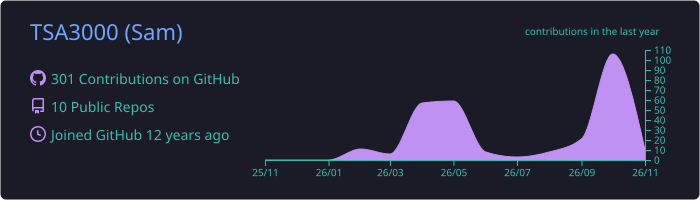
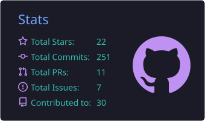
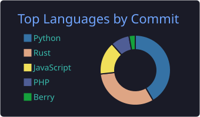
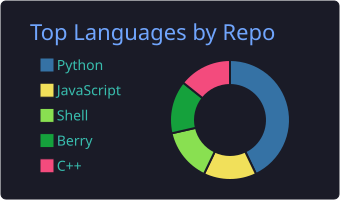
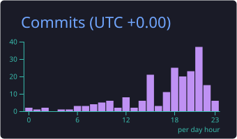

  

  

  
  
  
  

---

### 🧰 Tech I work with

  

---

### 📊 Live stats

  

  
  

  
  

  

---

### 🛠️ Repositories

<!-- STATS:START -->
<!-- STATS:END -->

<!-- REPOS:START -->
<!-- REPOS:END -->

---

### ⚡ Recent activity

<!-- ACTIVITY:START -->
<!-- ACTIVITY:END -->

---

<b>🔎 Why "TSA3000"?</b>

 

- **TSA** is the **Silver Arrow** from *The Legend of Zelda: A Link to the Past* (SNES), a powerful and fun arrow to get.
- **3000** was added because some platforms required usernames of at least 7 characters.

<b>📬 Feedback & support</b>

 

Found a bug or have an idea? Click **🐛 Issue** next to the project in the table above.

  

  

